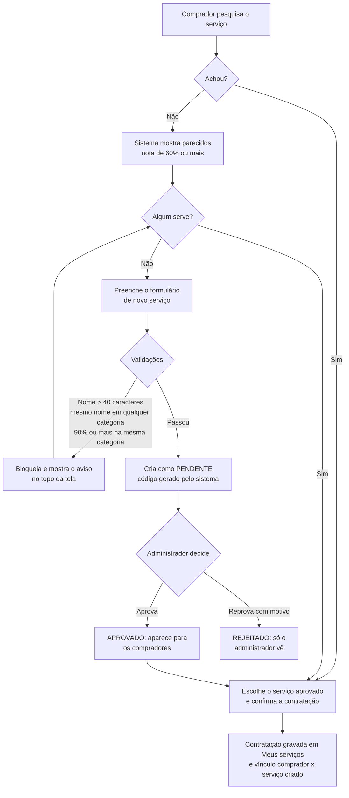

# 05 · Fluxo de governança de entrada

O fluxo tem quatro momentos: **consulta, sugestão, validação/bloqueio e aprovação**.

[← Voltar ao README](../README.md)

## 1. Consulta

O comprador digita o nome. O sistema compara com o índice de todos os serviços, que fica **em memória** e já traz o texto de cada serviço pré-processado. Assim a checagem é rápida: cerca de 8 ms para ~8 mil serviços (medição registrada no código, com a base real).

A busca acha o serviço se o nome digitado contém, ou está contido, no nome do catálogo, tanto na forma original quanto na normalizada (por isso `H EXTRA` acha `HORA EXTRA`). Devolve no máximo 50 candidatos. Para o comprador, **só entram serviços aprovados**.

## 2. Sugestão

Quando nada é encontrado, e também durante o cadastro, o sistema mostra até **5 serviços parecidos** com nota de **60% ou mais**, de **todas as categorias**. Serviços `REJEITADO` não aparecem. No formulário de novo serviço, os avisos e as sugestões aparecem **no topo da tela**.

## 3. Validação e bloqueio

Ao solicitar um novo serviço, o sistema aplica, nesta ordem:

| # | Regra | Resposta |
|---|---|---|
| 1 | Nome com mais de **40 caracteres** | Recusa (HTTP 400) |
| 2 | Categoria inexistente | Recusa (404) |
| 3 | Mesmo nome (padronizado) **na mesma categoria** | **Bloqueia** (409) |
| 4 | Mesmo nome (ignorando maiúsculas e acentos) em **qualquer outra categoria**, desconsiderando serviços reprovados | **Bloqueia** (409): *"Já existe um serviço com este nome na categoria X (CÓD)."* |
| 5 | Aderência **≥ 90%** com um serviço **da mesma categoria** | **Bloqueia** (409) e mostra o código existente |
| 6 | Categoria sem prefixo configurado | Recusa (422) |
| — | Passou em tudo | Cria como **PENDENTE** (201) |

O código só é gerado **depois** de passar por todas as validações, então um pedido recusado não "queima" número.

### Como a nota (0 a 100%) é calculada

Os dois nomes são normalizados (veja [Regra de nome](03-regra-de-nome-e-padronizacao.md)) e comparados:

1. Mesmas palavras, em qualquer ordem: **100%**.
2. Senão, a **maior** entre três medidas:
   - palavras em comum (Jaccard);
   - semelhança de letras (Dice sobre trigramas), que pega erro de digitação e nome truncado;
   - "um nome está dentro do outro": **80%**.
3. **Travas** (a nota fica limitada a **89%**, ou seja, nunca bloqueia, mas ainda pode sugerir):
   - os **números/medidas** são diferentes (`25MM` × `50MM`);
   - os **modificadores** são diferentes (`HE` × `HN`, `NOT`, `DF`...);
   - as palavras que diferem **não são variação de grafia**. Só é grafia quando uma palavra é começo da outra (truncamento) ou há 1 letra de diferença (2 em palavras de 8+ letras). Palavra realmente diferente (`EXT` × `INT`) ou palavra a mais só sugere.

### Exemplos (do teste automatizado)

| Nome A | Nome B | Resultado |
|---|---|---|
| `SV-EQUIPE TELHADO` | `EQUIPE TELHADO.` | **Bloqueia** (mesmo nome) |
| `AJUDANTE - HORA EXTRA À DISPOSIÇÃO` | `SV AJUDANTE HE DISP` | **Bloqueia** (siglas do dicionário) |
| `ELETRICISTA PERICULOSIDADE` | `ELETRICISTA PERIC` | **Bloqueia** |
| `SV - FURAÇÃO EM CONCRETO COM COROA DIAM` | `...COROA DIAMA` | **Bloqueia** (truncamento) |
| `TUBO RIGIDO SOLDAVEL 25MM` | `TUBO RIGIDO SOLDAVEL 25 MM` | Nota 100% (mesma medida) |
| `TUBO RIGIDO SOLDAVEL 25MM` | `TUBO RIGIDO SOLDAVEL 50MM` | Só **sugere** (medida diferente) |
| `AJUDANTE HE 50` | `AJUDANTE HE 100` | Não bloqueia (pode aparecer como sugestão) |
| `TECNICO SEGURANCA TRABALHO HORA NORMAL` | `... HORA EXTRA` | Não bloqueia (HN × HE) |
| `PORTA EXT SIMPLES` | `PORTA INT SIMPLES` | Não bloqueia (pode aparecer como sugestão) |
| `MOBILIZACAO DE EMERGENCIA >3DIAS` | `... <3DIAS` | Não bloqueia (pode aparecer como sugestão) |
| `AJUDANTE` | `PEDREIRO` | 0% |

A régua erra para o lado seguro: **prefere sugerir a bloquear** quando há dúvida. Um bloqueio indevido atrapalha o comprador; uma sugestão só pede um segundo de atenção. O bloqueio por **nome idêntico** (regras 3 e 4) é exato e não depende da nota.

## 4. Aprovação

O administrador vê a fila em **Aprovações**:

- **Aprovar:** o serviço vira `APROVADO`, entra no catálogo e passa a aparecer para os compradores.
- **Reprovar:** exige **motivo**. O serviço vira `REJEITADO`.
- **Pendentes e reprovados só o administrador vê.** Eles somem da Consulta, do Catálogo, das sugestões e da API para o comprador, e **não podem ser contratados** (o servidor recusa com 409 mesmo se alguém montar a requisição à mão).
- Só serviços `PENDENTE` podem ser decididos; uma segunda decisão sobre o mesmo pedido é recusada (409).

## 5. Contratação e vínculo

O comprador contrata um serviço **aprovado** informando quantidade, adicionais e observação. A contratação é **gravada** e aparece em **Meus serviços**. Se o usuário está ligado a um comprador da base, o **vínculo comprador × serviço** é criado sozinho, com a data (`vinculado_em`). O administrador também pode vincular manualmente na aba **Contratações**. Só serviços `APROVADO` aceitam vínculo, e o mesmo comprador não pode ser ligado duas vezes ao mesmo serviço.

## 6. Quem pode o quê

Existem **dois perfis**:

| Capacidade | Comprador | Administrador |
|---|---|---|
| Consulta e catálogo (serviços aprovados) | Sim | Não usa o Catálogo; vê **todos** os serviços na aba Serviços |
| Solicitar novo serviço | Sim | Não (decide as solicitações) |
| Contratar serviço aprovado e ver *Meus serviços* | Sim | Não |
| Aprovar/reprovar | Não | Sim |
| Alterar unidade de medida, unidade de custo e descrição | Não | Sim |
| Vincular compradores a serviços (Contratações) | Não | Sim |
| Importar catálogo e vínculos | Não | Sim |
| Aprovar pedidos de cadastro e gerir usuários | Não | Sim |

### Acesso e usuários

- Quem não tem acesso usa **Solicitar cadastro** na tela de login. O pedido fica pendente até o administrador **aprovar** (vira Comprador) ou **recusar**, na aba **Usuários**.
- O login é por **e-mail**. A senha é guardada só em BCrypt (mínimo de 8 caracteres).
- O administrador também pode criar usuários diretamente e **ligar cada usuário Comprador a um comprador da base**. **Cada comprador da base tem no máximo um usuário**; a regra também é garantida no banco.

## 7. Como o problema não volta

- O **bloqueio** impede a duplicata exata (em qualquer categoria) e a quase exata na categoria.
- A **sugestão** empurra o comprador para reutilizar o que já existe.
- A **aprovação** dá a uma pessoa a última palavra sobre cada código novo.
- O **código gerado pelo sistema** acaba com a criação manual e com a variação de formato.
- A **checagem rápida** não atrapalha o trabalho de quem cria o código.
